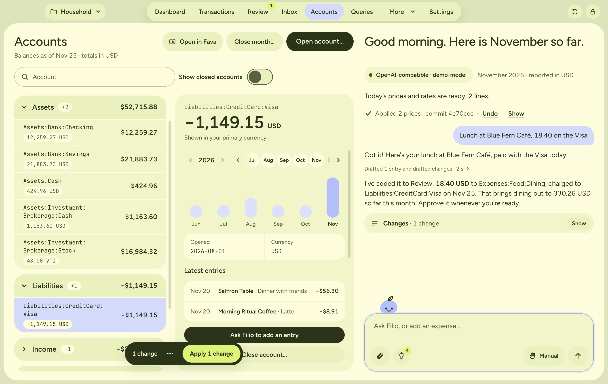
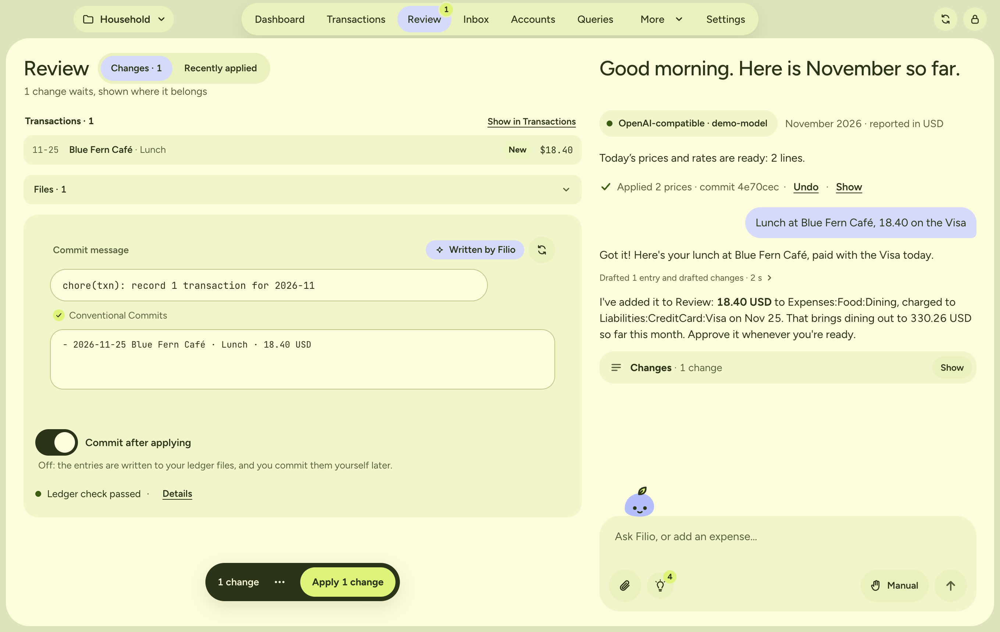

# Folio

Folio is a Mac app for keeping your personal accounts in a folder of
plain-text [Beancount](https://beancount.github.io/) files, with Filio, a
friendly AI bookkeeper, doing the busywork.


- **Tell Filio, or hand it a statement.** Type "Lunch at Blue Fern Café, 18.40
  on the Visa", or drop in a bank export (CSV, Excel, PDF or a photo of a
  receipt), and Filio drafts the entries.
- **Nothing is written until you approve it.** Every change arrives as a
  change set you can read line by line. It must pass `bean-check` before it is
  applied, and it is saved as a git commit, so it can always be undone.
- **Books kept like a careful bookkeeper would.** Entries go in date order
  into the right month file, in your ledger's own style.
- **Your data stays yours.** The ledger is ordinary text files in a folder you
  choose, synced through your own git remote, optionally encrypted with
  git-crypt. Names, account numbers and addresses are hidden before anything
  is sent to a model, and put back when the answer arrives.
- **Your choice of model.** Anthropic, OpenAI, Azure OpenAI, or any
  OpenAI-compatible server, including a model running on your own Mac.
- **Also:** dashboards, transactions by month, account balances, saved
  queries, voice input, a PIN lock, and [Fava](https://beancount.github.io/fava/)
  built in.

| Chat with Filio | Review every change |
|---|---|
|  |  |
| **Transactions by month** | **Light and dark** |
|  |  |

All data in these screenshots is made up.

## Download

Folio runs on Macs with Apple silicon, macOS 13 or later. Download the latest
disk image from
[Releases](https://github.com/0xnoahzhu/folio-releases/releases), open it, and
drag Folio to Applications.

If macOS says it cannot check Folio for malicious software the first time you
open it, go to System Settings → Privacy & Security and click **Open Anyway**.

## Move Folio to another Mac

Folio keeps two separate things, and each moves in its own way:

- **Your ledgers** are ordinary folders of `.bean` files, with their git
  history. They are yours, not Folio's.
- **Folio's own data** is one database, `folio.db`, in
  `~/Library/Application Support/Folio`.

If you move to the new Mac with Apple's **Migration Assistant**, both come
along with everything else and there is nothing more to do. The steps below
are for moving by hand, or for moving only part of Folio's data.

### What is in `folio.db`

| Kept in `folio.db` | Notes |
|---|---|
| Chats with Filio | Plus the masking key, which gives each hidden name or number the same stand-in every time it is sent to the model |
| Inbox documents (imported statements and receipts) | Including what Folio read from them |
| Changes waiting in Review | |
| What Filio remembers, and the categories it learned from your picks | |
| Settings, model profiles, recent ledgers | |
| **API keys** (model providers, speech) | Secret |
| **Sync tokens** for your git remotes | Secret |
| **Remembered PDF passwords** | Secret |
| **The lock PIN** (stored as a hash) | |

Everything else in `~/Library/Application Support/Folio` (caches, `logs`) is
not needed on the new Mac.

### 1. Move your ledgers first

- **With a git remote** (for example a private GitHub repository): clone it on
  the new Mac (`git clone …`). A ledger that uses encryption (git-crypt) also
  needs its exported key file: unlock the clone with it before choosing the
  folder in Folio. Folio carries git and git-crypt inside the app, so nothing
  needs to be installed:

  ```sh
  cd /path/to/your/ledger
  PATH="/Applications/Folio.app/Contents/Resources/git/bin:$PATH" \
    git-crypt unlock ~/Documents/folio-git-crypt.key
  ```
- **Without a remote:** copy the whole ledger folder, including the hidden
  `.git` folder.

> **Put each ledger at the same path as before**, for example
> `/Users/you/Documents/Ledger`, which also means the same macOS user name.
> Folio files chats, Inbox documents, waiting changes, memories and sync
> tokens under the ledger folder's full path. A ledger opened from a different
> path starts with none of them.

### 2. Move Folio's data

1. Install Folio on the new Mac, but **do not open it yet**. If you already
   opened it, quit it (⌘Q).
2. Quit Folio on the old Mac (⌘Q), so the database is complete on disk.
3. Copy these files from the old Mac to the same folder on the new Mac,
   `~/Library/Application Support/Folio` (create it if it is not there):
   - `folio.db`
   - `folio.db-wal` and `folio.db-shm`, if they exist
4. Open Folio on the new Mac.

This moves everything in the table above, including your API keys, sync
tokens and lock PIN. Copy the files over a connection you trust (a USB drive
you keep, AirDrop, or your own network), not through a shared or public
service: `folio.db` holds your keys in plain form.

### Move only some of it

Your chats, Inbox, waiting changes and memories cannot be split from each
other: they move together in `folio.db`. What you can leave behind are the
secrets and the lock PIN. Do this on the new Mac **after step 3 and before
step 4**, so Folio has not opened the database yet:

```sh
cd ~/Library/"Application Support"/Folio
cp folio.db folio.db.backup
sqlite3 folio.db "DELETE FROM secrets WHERE name = 'lock:pin';"
```

That removes only the lock PIN, so Folio opens without asking for one. You can
set a new PIN in Settings later. To leave other secrets behind too, add these
lines before opening Folio:

```sh
sqlite3 folio.db "DELETE FROM secrets WHERE name LIKE 'provider:%' OR name LIKE 'stt:%';"   # model and speech API keys
sqlite3 folio.db "DELETE FROM secrets WHERE name LIKE 'sync:%';"                            # sync tokens
sqlite3 folio.db "DELETE FROM secrets WHERE name LIKE 'pdf-password:%';"                    # remembered PDF passwords
sqlite3 folio.db "PRAGMA integrity_check;"                                                  # should print: ok
```

Then open Folio and enter the API keys and sync tokens again in Settings.

- **Keep `masking:key`.** If it were missing, Folio would make a new one, and
  a name from an earlier chat would get a different stand-in when you
  continue that chat: the model would see the same person under two names.
- `sqlite3` comes with macOS; nothing needs to be installed.
- If anything goes wrong, quit Folio and put `folio.db.backup` back as
  `folio.db`.
- Once the new Mac works, you can remove Folio from the old one as described
  below.

## Uninstall Folio completely

Removing Folio does not touch your ledgers. Your ledger folders, their git
history and any git remotes, for example a repository on GitHub, stay
exactly as they are.

### 1. Before you quit

- If **Open Folio in the background at login** is on (Settings → Notifications),
  turn it off.
- If your ledger uses encryption (git-crypt), make sure you still have the
  exported key file (Folio suggests `~/Documents/folio-git-crypt.key`).
  Without it an encrypted remote cannot be read.

Then quit Folio (⌘Q).

### 2. Remove the app

Drag **Folio** from Applications to the Trash.

### 3. Remove what Folio keeps on your Mac

| Location | What it holds |
|---|---|
| `~/Library/Application Support/Folio` | Folio's database `folio.db`: settings, model profiles, **API keys and sync tokens**, chats, documents in the Inbox (imported statements and receipts), masking maps, recent ledgers; call logs; the browser engine's caches |
| `~/Library/Logs/Folio` | App logs |
| `~/Library/Preferences/app.folio.desktop.plist` | macOS preferences (Open and Save panel size and last folder) |
| `~/Library/Caches/folio-ocr` | Text recognition cache, created by macOS when Folio reads an image or scanned PDF |
| `~/Library/Saved Application State/app.folio.desktop.savedState` | Window restoration, if macOS created it |

The first row holds your API keys and tokens. Remove it unless you will
reinstall Folio on this Mac and want to keep your settings.

**In Terminal** (deletes permanently; paste as one block):

```sh
rm -rf ~/Library/"Application Support"/Folio
rm -rf ~/Library/Logs/Folio
rm -rf ~/Library/Caches/folio-ocr
rm -rf ~/Library/"Saved Application State"/app.folio.desktop.savedState
defaults delete app.folio.desktop 2>/dev/null
rm -f ~/Library/Preferences/app.folio.desktop.plist
```

**Or in Finder:** choose Go → Go to Folder… (⇧⌘G), paste each path from the
table, and move what you find to the Trash. Then empty the Trash.

### 4. Reset permissions (optional)

macOS keeps the permissions you gave Folio: the microphone, and access to
folders such as Documents or Desktop if your ledgers are there. To clear them:

```sh
tccutil reset All app.folio.desktop
```

Notification settings are separate; macOS removes them on its own.

If Folio still appears in System Settings → General → Login Items (Login Items
& Extensions on macOS 15 and later), remove it there.

### 5. Inside your ledgers (optional)

A ledger where you saved rules for Filio has a `.folio` folder holding them
(`rules.md`). It is part of your ledger, so it is kept. If you will not use
Folio again and want no trace of it, delete `.folio` in that ledger folder and
commit the change.

### Nothing else

- Folio never uses the macOS Keychain, so there is nothing to remove there.
- The bundled tools (Python, Beancount, beanquery, beanprice, Fava, git,
  git-crypt) and Folio's helpers live inside Folio.app and are gone with it.
  Folio never writes to your `~/.gitconfig`.
- On-device speech models used by voice input belong to macOS, which
  manages them for all apps.

## License

Folio is free to download and use. Its source code is not public, except
Folio's ledger engine, which is GPL-2.0 (see below).

© 2026 Noah Zhu. All rights reserved.

### Folio and the GPL

Folio is built on [Beancount](https://github.com/beancount/beancount), which is
licensed under the GNU GPL version 2. Folio follows it like this:

- **Folio's ledger engine is GPL-2.0.** The engine is the small Python program
  inside Folio.app that loads, checks and queries your ledger. It uses
  Beancount directly (in the same process), so it counts as a work based on
  Beancount and is under the same license. Its source code ships inside
  Folio.app as readable Python files, in `Folio.app/Contents/Resources/engine/`.
- **The rest of Folio is a separate program.** The app you see (its window,
  Filio, privacy masking, sync) runs in its own process. It starts the engine,
  git and the other tools as separate programs and talks to them through
  pipes, the way any app runs a command-line tool. It contains no GPL code, so
  the GPL does not extend to it.
- **The bundled tools are included unchanged**, with their license texts.

You can get the complete source code of every GPL program in any Folio release,
including the engine, by opening an issue in this repository. This offer is
valid for at least three years after each release.

### Open-source software inside Folio

| Component | License | How Folio uses it | Source |
|---|---|---|---|
| Folio's ledger engine | GPL-2.0 | Separate program | Inside Folio.app |
| [Beancount](https://github.com/beancount/beancount), [beanquery](https://github.com/beancount/beanquery) | GPL-2.0 | Used by the engine | [PyPI](https://pypi.org/project/beancount/#files) |
| [beanprice](https://github.com/beancount/beanprice) | GPL-2.0 | Used by the engine | [PyPI](https://pypi.org/project/beanprice/#files) |
| [Fava](https://github.com/beancount/fava) | MIT | Separate program | [PyPI](https://pypi.org/project/fava/#files) |
| [Git](https://git-scm.com/) | GPL-2.0 | Separate program | [kernel.org](https://www.kernel.org/pub/software/scm/git/) |
| [git-crypt](https://www.agwa.name/projects/git-crypt/) | GPL-3.0 or later | Separate program | [agwa.name](https://www.agwa.name/projects/git-crypt/downloads/) |
| [Python](https://www.python.org/) | PSF-2.0 | Runs the engine | [python.org](https://www.python.org/downloads/source/) |
| [OpenSSL](https://www.openssl.org/) | Apache-2.0 | Inside git-crypt | [GitHub](https://github.com/openssl/openssl/releases) |
| [Electron](https://www.electronjs.org/) (with Chromium and Node.js), [React](https://react.dev/), i18next, Zustand, Zod | MIT (Chromium: BSD and others) | Part of the app | Their project pages |
| [Figtree](https://github.com/erikdkennedy/figtree) and [JetBrains Mono](https://github.com/JetBrains/JetBrainsMono) fonts | OFL-1.1 | Part of the app | Their project pages |

Each release bundles the latest stable version of these tools. In the app,
**Settings → About → Open source licenses** lists the exact versions, their
full license texts and a link to the source code of each one.
